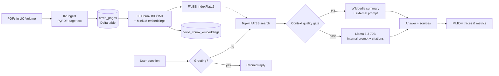

# COVID-19 Research Assistant — Agentic RAG on Databricks


A retrieval-augmented generation (RAG) assistant that answers COVID-19 questions from a set of PDF documents, cites the source file and page, and falls back to Wikipedia when the documents don't contain a good answer. The whole pipeline runs as five Databricks notebooks, with every stage stored in Unity Catalog and every run tracked in MLflow.

**Author:** Krushal Sardhara · Lambton College, AI & ML program · April 2026

---

## What it does

- **Ingests PDFs** page by page from a Unity Catalog Volume and stores the text as a Delta table
- **Chunks and embeds** the text (800-character chunks, 150 overlap) with `all-MiniLM-L6-v2` (384-dim vectors)
- **Searches** a FAISS `IndexFlatL2` index for the top 4 chunks per question
- **Routes each question** through three paths:
  - **Greeting** → instant canned reply, no retrieval
  - **Internal** → answer from the PDFs with Llama 3.3 70B, citing file + page
  - **External** → if retrieved context fails a quality gate, answer from a Wikipedia summary (plus a YouTube search link)
- **Remembers** the last 6 conversation turns so follow-ups like *"what was my last question?"* work
- **Evaluates itself** on 12 test questions and logs route accuracy and latency to MLflow

## Architecture



### Context quality gate

Retrieved chunks are only used when **all** of these hold (`internal_context_good_enough` in `04_rag_chain.py`):

| Check | Threshold |
| --- | --- |
| Number of chunks returned | ≥ 2 |
| Total characters of context | ≥ 250 |
| Average L2 distance | ≤ 1.2 |
| Keyword overlap between question and context | ≥ 1 word |

Otherwise the question goes to the external (Wikipedia) route. This stops the model from writing a confident answer out of loosely related chunks.

## Notebooks

| Notebook | Stage | Output |
| --- | --- | --- |
| [`01_setup.py`](notebooks/01_setup.py) | Install dependencies | — |
| [`02_ingest_pdfs.py`](notebooks/02_ingest_pdfs.py) | Read PDFs page by page, drop pages under 50 characters | `main.covid_rag.covid_pages` |
| [`03_chunk_embed_index.py`](notebooks/03_chunk_embed_index.py) | Chunk, embed, build FAISS index | `covid_chunks`, `covid_chunk_embeddings`, `faiss_index.bin`, `chunk_metadata.pkl` |
| [`04_rag_chain.py`](notebooks/04_rag_chain.py) | Retrieval, routing, prompts, chat memory, `chat()` interface | MLflow traces |
| [`05_evaluation.py`](notebooks/05_evaluation.py) | 12-question evaluation, route accuracy and latency | MLflow run `covid_rag_evaluation`, `evaluation_results.csv` |

The notebooks are in Databricks source format (`.py` with `# COMMAND ----------` separators), so they can be imported straight into a Databricks workspace.

## Tech stack

| Area | Tools |
| --- | --- |
| Platform | Databricks (Free Edition), Unity Catalog, Delta tables, Volumes |
| Retrieval | Sentence Transformers (`all-MiniLM-L6-v2`), FAISS |
| Generation | Meta Llama 3.3 70B Instruct via `databricks-langchain` `ChatDatabricks` (temperature 0.1, max 400 tokens) |
| Orchestration | LangChain prompt templates, custom routing in Python |
| Tracking | MLflow (`mlflow.langchain.autolog()`, metrics, artifact tables) |
| Other | PyPDF, pandas, Wikipedia REST API |

## How to run it

1. **Databricks workspace** with access to the Foundation Model endpoint `databricks-meta-llama-3-3-70b-instruct` (available in Databricks Free Edition at the time of the project).
2. **Create the storage** used by the notebooks:
   ```sql
   CREATE SCHEMA IF NOT EXISTS main.covid_rag;
   CREATE VOLUME IF NOT EXISTS main.covid_rag.covid_docs;
   ```
3. **Upload your COVID-19 PDF documents** to `/Volumes/main/covid_rag/covid_docs/`. The source PDFs are not included in this repository.
4. **Import the notebooks** in `notebooks/` into your workspace and run them in order: `01` → `02` → `03` → `04`.
5. **Chat with it** from any cell after running `04_rag_chain`:
   ```python
   chat("What are common symptoms of COVID-19?")
   chat("What was my last question?")   # uses conversation memory
   show_history()
   clear_history()
   ```
6. **Evaluate** by running `05_evaluation`, then open *Experiments → /Shared/covid_rag_experiments → covid_rag_evaluation* in MLflow.

## Evaluation design

The test set has 12 questions: 9 that the documents should answer (symptoms, transmission, long COVID, prevention, vaccination, severity, treatment, public-health guidance, long-term effects) and 3 that should fall back (travel restrictions, live 2026 case counts, airline policies). For each question the notebook records the route taken, whether it matched the expected route, the number of sources and the end-to-end latency, then logs:

- `route_accuracy`, `avg_total_latency_sec`, `internal_route_rate`, `external_route_rate`
- a per-question results table (`evaluation_results.json`) and a CSV copy in the Volume
- a manual scoring template (relevance, groundedness, retrieval, overall on a 1–5 scale)

See [`docs/covid_rag_report.pdf`](docs/covid_rag_report.pdf) for the write-up and how to read the MLflow results.

## What I learned

- **Routing quality mattered more than retrieval quality.** Sending weak-context questions to Wikipedia beat a confident wrong answer.
- **Chunk size changes answer completeness.** 800 characters with 150 overlap kept sentences intact without diluting relevance.
- **L2 distance alone is not a reliable relevance signal**, which is why the keyword-overlap check was added.
- **MLflow tracing made debugging possible**: it showed whether a bad answer came from retrieval or generation.
- **Chat memory needs a cap.** Six turns kept follow-ups working without crowding out the retrieved context.

## Limitations and next steps

- The chat runs inside a notebook (Gradio had connection issues on serverless compute); a Streamlit or Databricks App front end is a natural next step.
- The keyword-overlap check is a simple word match; a cross-encoder re-ranker would be a stronger relevance filter.
- Answer quality is scored by hand with the included template; automated metrics (for example LLM-as-judge groundedness) would make evaluation repeatable.
- FAISS is rebuilt from scratch; Databricks Vector Search would allow incremental updates.

## Repository structure

```
covid19-rag-assistant/
├── notebooks/
│   ├── 01_setup.py
│   ├── 02_ingest_pdfs.py
│   ├── 03_chunk_embed_index.py
│   ├── 04_rag_chain.py
│   └── 05_evaluation.py
├── docs/
│   └── covid_rag_report.pdf
├── requirements.txt
└── README.md
```
